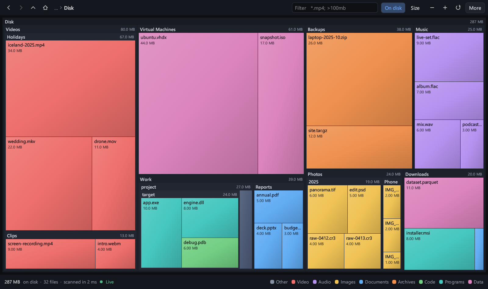

# SpaceScope

A fast disk-space treemap for Windows 10+ and Debian/Ubuntu, written in Rust.
It is a from-scratch take on the idea behind SpaceSniffer: scan a drive or
folder, and see every file and folder as a rectangle sized by the space it uses.



## What it does

- **Live scan.** The map fills in while the scan runs; you can navigate before it finishes.
- **Live updates.** After the scan the folder is watched, and the map follows files as they are created, grown or deleted.
- **NTFS fast path.** Run as administrator on Windows and whole drives are read from the master file table in a couple of seconds.
- **Zoom.** Double-click a folder to zoom in, with an animated transition. Back, forward and up work like a browser.
- **Filter.** `*.mp4; >100mb; <30days` narrows the map to matching files as you type.
- **On disk or logical size.** Compressed, sparse and cloud-placeholder files are shown at the space they really occupy, or at their nominal size.
- **Free space.** Optionally shows the volume's free space as a tile when you scan a whole drive.
- **File actions.** Open, show in the file manager, copy path, move to the Recycle Bin / Trash, rescan a folder in place.
- **Export.** Any folder can be exported as CSV, from the app or from the `sscan` command-line tool.
- **Dark and light themes**, following the system by default.

## Install

Downloads are on the [releases page](https://github.com/SkippyNet/spacescope/releases/latest); there is also a [project page](https://skippynet.github.io/spacescope/).

**Windows:** unzip `SpaceScope-windows-x64.zip` and run `spacescope.exe`. Nothing to install, no administrator rights needed. For the fast drive scan choose **More → Restart as administrator**.

**Debian / Ubuntu** (22.04+ / Debian 12+):

```sh
sudo apt install ./spacescope-amd64.deb
spacescope            # or launch it from the application menu
```

## Build from source

Needs Rust 1.87 or newer. On Linux a C linker is the only other requirement (`sudo apt install build-essential`).

```sh
cargo build --release
./target/release/spacescope            # GUI
./target/release/sscan /some/path      # command line
```

Packages: `scripts/package-windows.ps1` writes a zip to `dist/`; `scripts/package-deb.sh` writes a `.deb`.
Build the `.deb` on the oldest release you want to support (CI uses Ubuntu 22.04), because the binary links against that system's glibc.

## Using it

| Action | Mouse | Keyboard |
|---|---|---|
| Zoom into a folder | double-click, or scroll up over it | |
| Zoom out | scroll down | `Alt+Up` |
| Back / forward | mouse back / forward buttons | `Alt+Left` / `Alt+Right`, `Backspace` |
| Select | click | |
| File actions | right-click | |
| More / less detail | `+` / `−` buttons | `+` / `-` |
| Filter | | `Ctrl+F`, `Esc` clears |
| Rescan the current folder | refresh button | `F5` |

You can also start a scan directly: `spacescope C:\Users\me`, or drop a folder onto the window.

### Filter syntax

Terms are separated by `;`. Name terms are OR-ed, everything else is AND-ed.

| Term | Meaning |
|---|---|
| `*.jpg`, `IMG_????.*` | name pattern (`*` and `?`), case-insensitive |
| `steam` | name contains the text; a matching folder brings its whole content |
| `>100mb`, `<2gb` | size limits (`b`, `kb`, `mb`, `gb`, `tb`) |
| `>2years` | older than (`sec`, `min`, `hours`, `days`, `weeks`, `months`, `years`) |
| `<30days` | newer than |
| `\|*.tmp` or `!*.tmp` | exclude |

### Command line

```
sscan [PATH] [--top N] [--threads N] [--logical] [--filter EXPR] [--csv FILE] [--bench] [--no-mft]
```

## How it is fast

- **The NTFS master file table, when allowed (Windows, administrator).** Every file on the volume has a 1 KiB record with its name, parent and sizes. Reading that table sequentially replaces hundreds of thousands of folder opens. It is used for drives and their top-level folders; anything unexpected falls back to the folder walk.
- **One system call per directory, not per file (Windows).** `GetFileInformationByHandleEx(FileFullDirectoryInfo)` returns names, both sizes, attributes and timestamps for hundreds of entries at once.
- **Raw `getdents64` + `fstatat` relative to the open directory (Linux).** No path is ever re-resolved.
- **Work-stealing thread pool.** Each worker reads a directory, appends it to the tree under one short lock, and queues the sub-directories.
- **Compact tree.** 48 bytes per node plus the name, in two flat arrays. A directory's children are contiguous, so whole-tree passes (filters, totals) are single linear loops.
- **The UI thread never computes.** Layout and filtering run on a worker; the window only draws the newest finished layout, as one batched mesh.
- **Only what is visible is laid out.** Folders too small to read stay collapsed and tiny siblings merge into one tile, so a drive with a million files still produces a few thousand rectangles.

Measured on the development machine (16 logical cores, NVMe SSD, Windows 11 with Defender on):

| Scan | Entries | Time (warm cache) |
|---|---|---|
| Whole `C:` drive, administrator (file table) | 1,311,000 | 2.4 s |
| Whole `C:` drive, standard user (folder walk) | 1,350,000 | 8 – 10 s (49 s on the first, cold run) |
| Home folder, Windows, standard user | 585,000 | 1.4 – 1.9 s |
| Home folder, Ubuntu on WSL2 | 491,000 | 2.3 s |
| `/usr`, Ubuntu on WSL2 | 89,000 | 0.3 s |

Totals were checked against PowerShell (`Get-ChildItem -Recurse`) on Windows and `du -x` on Linux and match to the byte.
With the whole drive loaded the app uses about 260 MB; a treemap layout takes 2 – 10 ms.

## Things to know

- **Unreadable folders** (shown in the status bar) are skipped. Run as administrator / with `sudo` to include them.
- **Links are not followed.** Symlinks and junctions are listed but never descended, so nothing is counted twice.
- **Hard links** are counted once on Linux and in the administrator scan on Windows. The standard-user scan on Windows counts every link, as Explorer does, so `C:\Windows\WinSxS` looks larger than it is.
- **The administrator scan sees more.** It includes system files Explorer hides (`$MFT`, `System Volume Information`), alternate data streams and folder indexes, so its on-disk totals run slightly higher. File sizes match the folder walk exactly.
- **Other filesystems** mounted below the scanned folder are skipped on Linux (like `du -x`); scan them from the start screen.
- **Live updates** re-read each folder that reports a change about a second after things go quiet. On Linux every folder needs its own inotify watch, so trees beyond the system's watch limit (or 250,000 folders) are not watched; the status bar says so, and `F5` rescans. If changes arrive faster than they can be tracked the indicator turns amber until you rescan. Turn the feature off under **More**.
- **Rendering** uses OpenGL by default because it needs far less memory. If OpenGL cannot start, the app restarts itself on wgpu (Direct3D 12 / Vulkan). `SPACESCOPE_RENDERER=wgpu` or `=gl` forces one.

## Layout of the code

```
crates/core   scanner, tree, filter language, treemap layout, CSV export, sscan CLI
crates/app    the window: rendering, theme, navigation, platform integration
```

`cargo test` covers the tree, filters, layout geometry and a real scan of a temporary directory.
The GUI has a built-in driver for end-to-end checks without touching the real mouse:

```sh
spacescope some/folder --size 1200x760 \
  --script "dbl:0.6,0.2;shot:zoomed.png;key:Backspace;rclick:0.2,0.5;shot:menu.png"
```

## License

MIT. The name and the idea of a live treemap owe a debt to SpaceSniffer by Uderzo Software; no code is shared with it.
